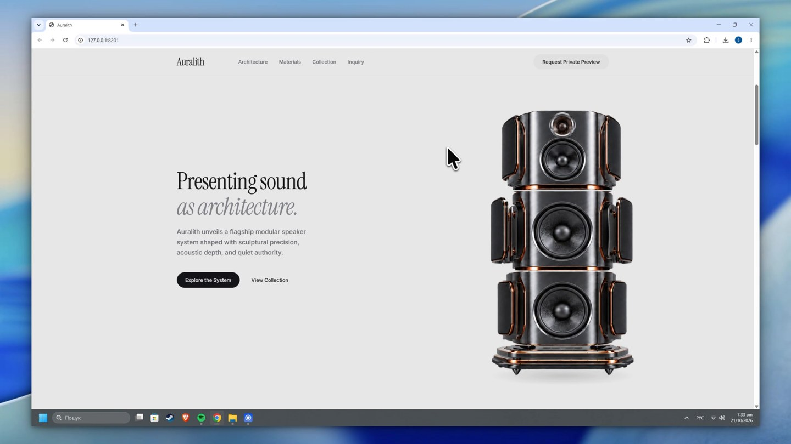

# Auralith

A premium speaker concept website exploring sound as architecture. Built as a frontend portfolio project to explore product presentation, motion and visual storytelling.

[](https://github.com/Kredickoa/auralith-scroll/raw/refs/heads/main/demo/demo.mp4)

[Watch the demo video](https://github.com/Kredickoa/auralith-scroll/raw/refs/heads/main/demo/demo.mp4)

## Highlights

- Scroll-driven speaker deconstruction rendered with Canvas 2D.
- Editorial product storytelling and a signature finish collection.

## Stack

React 19, TypeScript, Vite, Tailwind CSS, Motion, Canvas 2D and Base UI.

## Run locally

Requires Node.js 22.12+ and npm.

```bash
npm ci
npm run dev
```

Create a production build with `npm run build`, then run `npm run preview` to preview it.

Concept project, not a live commercial service. Any enquiry, cart or booking controls are demonstrations.

## Rights

All rights reserved. Shared for portfolio review; reuse requires prior written permission. See [LICENSE](LICENSE). Third-party materials retain their own licenses.
